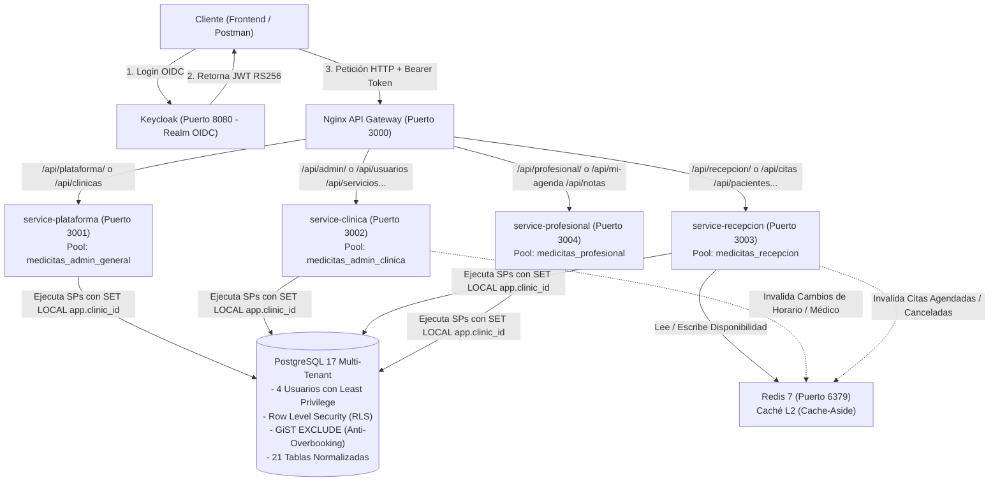
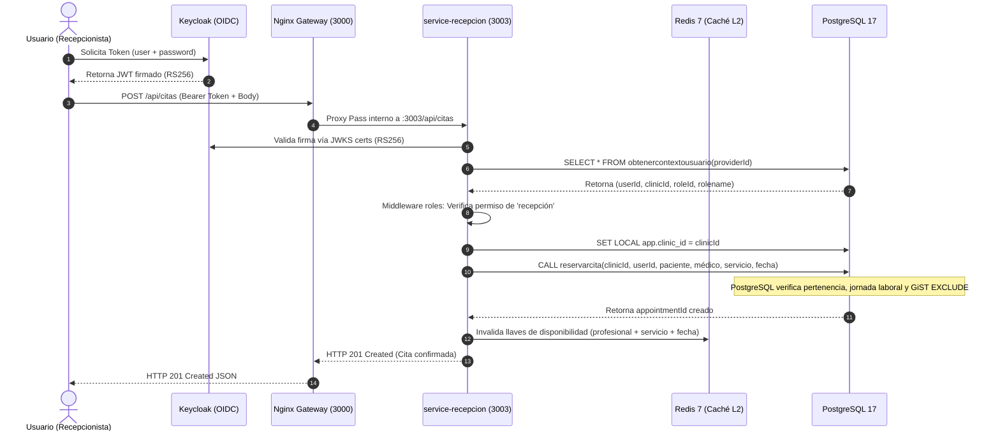
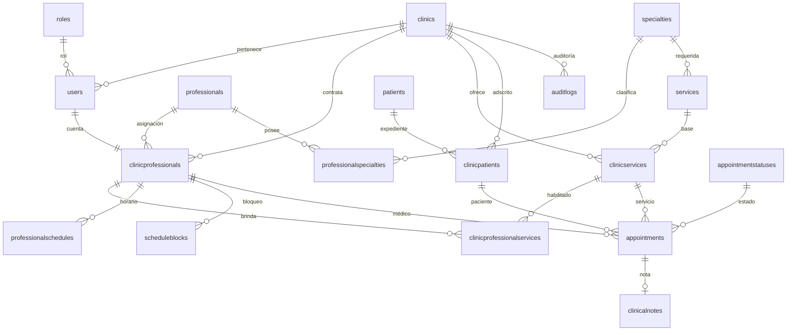
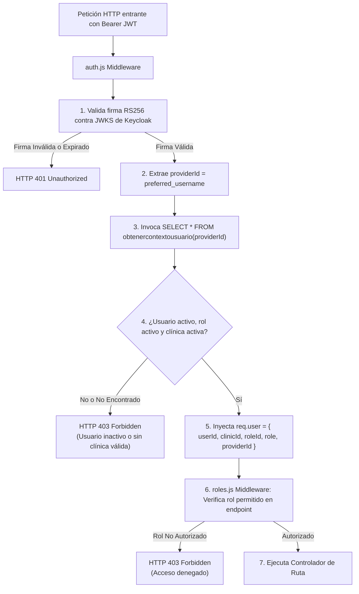
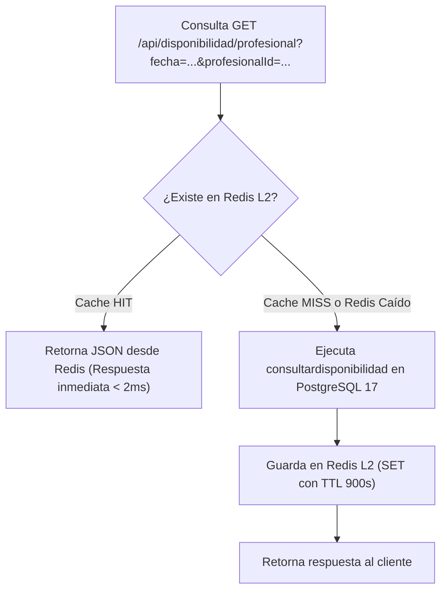

# MediCitas — Plataforma Multi-Clínica de Gestión de Citas y Agendas Médicas

> **Documentación Técnica Integral del Sistema**  
> *Arquitectura de Microservicios, Seguridad Zero-Trust, Base de Datos PostgreSQL 17 con RLS y Procedimientos Almacenados, Keycloak OIDC, Nginx API Gateway y Caché L2 en Redis.*

---

## Tabla de Contenidos

1. [Visión General del Sistema](#1-visión-general-del-sistema)
2. [Arquitectura General y Flujo de Comunicación](#2-arquitectura-general-y-flujo-de-comunicación)
3. [Jerarquía y Estructura Completa de Carpetas](#3-jerarquía-y-estructura-completa-de-carpetas)
4. [Mundo de la Base de Datos (PostgreSQL 17)](#4-mundo-de-la-base-de-datos-postgresql-17)
   - 4.1. Modelo Entidad-Relación y Tablas
   - 4.2. Principio Rector: Cero SQL Directo desde el Backend
   - 4.3. Prevención de Conflictos y Concurrencia Física (GIST y EXCLUDE)
   - 4.4. Aislamiento Multi-Tenant: Row-Level Security (RLS) y `app.clinic_id`
   - 4.5. Principio de Menor Privilegio: 4 Roles Técnicos y 4 Usuarios de Conexión
   - 4.6. Catálogo Exhaustivo de Procedimientos y Funciones Almacenadas
   - 4.7. Mecanismo de Auditoría Inmutable
5. [Seguridad, Identidad y Autorización (Keycloak + PostgreSQL)](#5-seguridad-identidad-y-autorización-keycloak--postgresql)
   - 5.1. El Token JWT y su Validación Criptográfica Asimétrica (RS256 / JWKS)
   - 5.2. Resolución de Identidad Segura mediante `obtenercontextousuario`
   - 5.3. El Rol de Plataforma vs Roles de Clínica
6. [Matriz de Permisos, Extensión y Justificaciones](#6-matriz-de-permisos-extensión-y-justificaciones)
   - 6.1. Comparativa Milimétrica: Requerimiento Original vs Sistema Implementado
   - 6.2. Primera Extensión Justificada: Consulta de Profesionales para Recepción y Médico
   - 6.3. Segunda Extensión Justificada: Consulta de Servicios para Recepción y Médico
7. [Mundo de la Caché L2 (Redis 7)](#7-mundo-de-la-caché-l2-redis-7)
   - 7.1. ¿Por qué Redis y exactamente qué datos se almacenan?
   - 7.2. Política de Invalidación Quirúrgica y Fail-Safe Silencioso
   - 7.3. Protección de Privacidad y Zonas Horarias
8. [Catálogo Completo de Rutas y Microservicios (Endpoints)](#8-catálogo-completo-de-rutas-y-microservicios-endpoints)
   - 8.1. API Gateway (Nginx) y Enrutamiento Inteligente
   - 8.2. Microservicio `admin-plataforma` (Puerto 3001)
   - 8.3. Microservicio `admin-clinica` (Puerto 3002)
   - 8.4. Microservicio `recepcion` (Puerto 3003)
   - 8.5. Microservicio `profesional` (Puerto 3004)
9. [Estándar Global de Respuestas y Manejo de Errores](#9-estándar-global-de-respuestas-y-manejo-de-errores)
10. [Justificación de Decisiones Tecnológicas y de Diseño](#10-justificación-de-decisiones-tecnológicas-y-de-diseño)
11. [Guía de Despliegue, Configuración y Puesta en Marcha](#11-guía-de-despliegue-configuración-y-puesta-en-marcha)
12. [Autores y Créditos del Proyecto](#12-autores-y-créditos-del-proyecto)

---

## 1. Visión General del Sistema

**MediCitas** es una plataforma tecnológica diseñada para resolver el problema de la administración médica en entornos **multi-clínica**. Permite que diversas clínicas independientes compartan la misma infraestructura de software y base de datos, garantizando de forma absoluta que los datos médicos, administrativos y de agenda de una clínica **jamás se mezclen ni sean accesibles por otra**.

El sistema fue concebido bajo el principio de **Defensa en Profundidad (Defense in Depth)** y **Cero Confianza (Zero-Trust)**:
- Ninguna solicitud entra al sistema sin un token criptográfico emitido por Keycloak.
- Ningún microservicio confía ciegamente en lo que el usuario envía en el cuerpo de la petición (`body` o `params`); la identidad real y la clínica se resuelven en la base de datos a partir del token firmado.
- Los microservicios no tienen permiso para hacer `SELECT`, `INSERT`, `UPDATE` ni `DELETE` sobre las tablas de la base de datos: **todas las operaciones se ejecutan a través de Procedimientos Almacenados (Stored Procedures) y Funciones PL/pgSQL**.
- La base de datos aplica **Row-Level Security (RLS)** forzado a nivel de motor, de modo que incluso si una consulta intentara filtrar información de otra clínica, el motor de PostgreSQL la bloquearía de raíz.
- Los conflictos de agenda (citas duplicadas, traslapes de médicos o pacientes) no se dejan a la suerte del código en Node.js; se resuelven mediante **índices GiST y restricciones de exclusión temporal física** en la base de datos.

---

## 2. Arquitectura General y Flujo de Comunicación

El proyecto adopta una arquitectura orientada a microservicios desacoplados por dominio de negocio, coordinados por un Gateway perimetral:



### Diagrama de Secuencia del Ciclo de Vida de una Petición



### El Ciclo de Vida de una Petición (Paso a Paso):
1. **Autenticación en Keycloak**: El usuario (por ejemplo, una recepcionista) envía sus credenciales al servidor de Keycloak (`medicitas-api`) y obtiene un token JWT firmado asimétricamente con el algoritmo **RS256**.
2. **Ingreso por el API Gateway**: El cliente invoca `POST http://localhost:3000/api/citas` adjuntando el encabezado `Authorization: Bearer <token>`. Nginx recibe la petición en el puerto 3000, evalúa la URI y la redirige internamente a `http://service-recepcion:3003/api/citas`.
3. **Validación de Token en Express (`auth.js`)**: El microservicio extrae la clave pública del JWKS (*JSON Web Key Set*) de Keycloak y valida que el token no haya sido alterado, que no haya expirado y que provenga de una fuente de confianza.
4. **Resolución de Contexto (`obtenercontextousuario`)**: El microservicio no confía en el `role` que viene en el JWT para consultar la base de datos. Toma el identificador único (`providerId`) y consulta a PostgreSQL mediante la función `obtenercontextousuario(providerId)`. PostgreSQL verifica que el usuario exista, esté activo y pertenezca a una clínica activa, retornando su `userId`, su `clinicId` y su rol real.
5. **Verificación de Rol en Ruta (`roles.js`)**: El middleware de ruta confirma si el rol del usuario figura dentro de los roles autorizados para consumir el recurso. Si no, rechaza inmediatamente con `403 Forbidden`.
6. **Ejecución en PostgreSQL**: Se establece la variable de sesión `SET LOCAL app.clinic_id = <clinicId>` (aislando automáticamente las tablas mediante RLS) y se ejecuta el Procedimiento Almacenado correspondiente usando el usuario de conexión del microservicio (que tiene permisos exclusivos concedidos en `BD/12-roles.sql`).
7. **Control de Concurrencia Física**: La base de datos bloquea el registro o evalúa las restricciones de exclusión (`EXCLUDE USING gist`). Si dos recepcionistas intentan reservar la misma cita en el mismo milisegundo, la base de datos lanza un error de exclusión `23P01` y el microservicio lo transforma en un `409 Conflict` perfectamente legible para el usuario.
8. **Invalidación de Caché**: Si la cita se reservó exitosamente, el servicio de recepción invalida las llaves de disponibilidad en Redis para esa clínica, fecha y profesional, asegurando que ninguna otra consulta vea horarios obsoletos.

---

## 3. Jerarquía y Estructura Completa de Carpetas

A continuación se detalla la estructura física del proyecto con la responsabilidad exacta de cada directorio y archivo:

```
MediCitas/
├── .env.example                     # Plantilla de variables de entorno para Docker Compose
├── .env.local                       # Variables de entorno para ejecución local fuera de contenedores
├── docker-compose.yml               # Orquestación global: 4 microservicios, Gateway, DB, Keycloak, Redis
├── package.json                     # Configuración de pruebas globales del workspace
├── prueba-concurrencia.js           # Script de prueba de estrés para citas simultáneas
│
├── BD/                              # ================= MUNDO DE BASE DE DATOS =================
│   ├── 01-creacion.sql              # DDL: Creación de tablas, llaves foráneas y restricciones EXCLUDE
│   ├── 02-seeding.sql               # Datos iniciales (roles, especialidades, estados de citas, auditoría)
│   ├── 03-auditoriaSP.sql           # Procedimiento registrarlog y función consultarlogs
│   ├── 04-citasAgendaSP.sql         # SPs: reservarcita, reprogramarcita, cambiarestadocita, etc.
│   ├── 05-clinicasUsuariosSP.sql    # SPs: crearclinica, crearusuario, cambiarrol, obtenerdetallecita
│   ├── 06-disponibilidadSP.sql      # Funciones: consultardisponibilidad y consultardisponibilidadservicio
│   ├── 07-horariosBloqueosSP.sql    # SPs: crear/actualizar horario semanal y bloqueos excepcionales
│   ├── 08-notasClinicasSP.sql       # SPs: crearnota, consultarnota, actualizarnota
│   ├── 09-pacientesSP.sql           # SPs: crearpaciente, actualizarpaciente, consultarpacientes
│   ├── 10-profesionalesEspecialidadesSP.sql # SPs: gestión de médicos, asignación de especialidades
│   ├── 11-serviciosSP.sql           # SPs: gestión del catálogo de servicios y mapeo con médicos
│   ├── 12-roles.sql                 # Seguridad DCL: Creación de roles de BD y asignación de permisos a SPs
│   ├── 13-usuarios.sh               # Script bash que crea los usuarios de conexión LOGIN en PostgreSQL
│   ├── 14-identidad.sql             # Función segura obtenercontextousuario para resolver identidad OIDC
│   ├── 15-RLS.sql                   # Row Level Security: políticas, función app.clinic_id y rol_security
│   └── diseñoDB.md                  # Documento de diseño original del modelo relacional
│
├── gateway/                         # ================= PUERTA DE ENTRADA =====================
│   ├── Dockerfile                   # Imagen ligera de Nginx Alpine
│   └── nginx.conf                   # Reglas de enrutamiento inverso y reescritura hacia microservicios
│
├── keycloak/                        # ================= GESTIÓN DE IDENTIDAD ===================
│   └── realm-medicitas.json         # Exportación oficial del Realm: roles, clientes y usuarios semilla
│
├── pruebas/                         # ================= SUITE DE PRUEBAS AUTOMATIZADAS =========
│   ├── jest.config.js               # Configuración de ejecución del framework Jest
│   ├── package.json                 # Dependencias de prueba (jest, supertest, jsonwebtoken)
│   ├── helpers/
│   │   └── auth.js                  # Utilidad para generar tokens y simular firmas en pruebas
│   ├── integracion/
│   │   ├── auth.test.js             # Pruebas de integración del flujo de autenticación y tokens
│   │   └── gateway.test.js          # Pruebas de integración del Gateway y healthchecks
│   └── unitarias/
│       ├── agenda.test.js           # Pruebas unitarias de cálculo de agendas
│       ├── clinicas.test.js         # Pruebas unitarias de creación de clínicas
│       ├── servicios-profesionales.test.js # Pruebas unitarias de asignación de servicios
│       └── usuarios.test.js         # Pruebas unitarias de ciclo de vida de usuarios
│
├── scripts/
│   └── test.js                      # Script utilitario en Node para orquestar la suite de pruebas
│
└── services/                        # ================= LOS 4 MICROSERVICIOS ===================
    │
    ├── admin-plataforma/            # --- MICROSERVICIO DE ADMINISTRADOR DE PLATAFORMA ---
    │   ├── Dockerfile               # Contenedor Node.js 20 Alpine (Puerto 3001)
    │   ├── package.json             # Dependencias: express, pg, jsonwebtoken, jwks-rsa
    │   └── src/
    │       ├── app.js               # Servidor Express, middlewares globales, 404 JSON y errores
    │       ├── config/database.js   # Pool de conexiones conectado como medicitas_admin_general
    │       ├── middlewares/
    │       │   ├── auth.js          # Validador de token OIDC y extractor de providerId
    │       │   └── roles.js         # Control de acceso basado en roles (RBAC)
    │       ├── repositorios/
    │       │   └── clinicas_repos.js # Llamadas a procedimientos crearclinica y consultarclinicas
    │       ├── rutas/
    │       │   └── clinicas_rts.js  # Definición de endpoints /api/clinicas
    │       └── servicios/
    │           └── clinicas_servicio.js # Lógica de negocio y orquestación de clínicas
    │
    ├── admin-clinica/               # --- MICROSERVICIO DE ADMINISTRADOR DE CLÍNICA ---
    │   ├── Dockerfile               # Contenedor Node.js 20 Alpine (Puerto 3002)
    │   ├── package.json             # Dependencias: express, pg, ioredis, jsonwebtoken, jwks-rsa
    │   └── src/
    │       ├── app.js               # Servidor Express (Puerto 3002)
    │       ├── config/
    │       │   ├── database.js      # Pool de conexiones conectado como medicitas_admin_clinica
    │       │   └── redis.js         # Cliente Redis para invalidación de caché ante cambios
    │       ├── middlewares/
    │       │   ├── auth.js          # Validación OIDC y resolución de usuario local
    │       │   └── roles.js         # Middleware RBAC
    │       ├── repositorios/
    │       │   ├── auditoria_repos.js     # Ejecución de consultarlogs
    │       │   ├── bloqueos_repos.js      # Ejecución de crearbloqueo, actualizarbloqueo, etc.
    │       │   ├── horarios_repos.js      # Ejecución de crearhorario, actualizarhorario, etc.
    │       │   ├── profesionales_repos.js # Ejecución de SPs de médicos y especialidades
    │       │   ├── servicios_repos.js     # Ejecución de SPs de servicios médicos
    │       │   └── usuarios_repos.js      # Ejecución de crearusuario, cambiarrol, etc.
    │       ├── rutas/
    │       │   ├── auditoria_rts.js       # Endpoints /api/auditoria
    │       │   ├── bloqueos_rts.js        # Endpoints /api/bloqueos
    │       │   ├── horarios_rts.js        # Endpoints /api/horarios
    │       │   ├── profesionales_rts.js   # Endpoints /api/profesionales
    │       │   ├── servicios_rts.js       # Endpoints /api/servicios
    │       │   └── usuarios_rts.js        # Endpoints /api/usuarios
    │       └── servicios/                 # Lógica de dominio e invalidación de caché
    │
    ├── recepcion/                   # --- MICROSERVICIO DE RECEPCIÓN ---
    │   ├── Dockerfile               # Contenedor Node.js 20 Alpine (Puerto 3003)
    │   ├── package.json             # Dependencias: express, pg, ioredis, jsonwebtoken
    │   └── src/
    │       ├── app.js               # Servidor Express (Puerto 3003)
    │       ├── config/
    │       │   ├── database.js      # Pool de conexiones conectado como medicitas_recepcion
    │       │   └── redis.js         # Cliente Redis L2 (lectura de caché e invalidación de citas)
    │       ├── middlewares/
    │       │   ├── auth.js          # Verificación JWT + contexto de usuario
    │       │   └── roles.js         # Control de roles
    │       ├── repositorios/
    │       │   ├── citas_repos.js         # Ejecución de reservarcita, reprogramarcita, cancelarcita
    │       │   ├── disponibilidad_repos.js# Ejecución de consultardisponibilidad (médico/servicio)
    │       │   └── pacientes_repos.js     # Ejecución de crearpaciente, actualizarpaciente
    │       ├── rutas/
    │       │   ├── citas_rts.js           # Endpoints /api/citas
    │       │   ├── disponibilidad_rts.js  # Endpoints /api/disponibilidad
    │       │   └── pacientes_rts.js       # Endpoints /api/pacientes
    │       └── servicios/                 # Orquestación con Redis L2 (Cache-Aside Pattern)
    │
    └── profesional/                 # --- MICROSERVICIO DEL PROFESIONAL DE SALUD ---
        ├── Dockerfile               # Contenedor Node.js 20 Alpine (Puerto 3004)
        ├── package.json             # Dependencias: express, pg, jsonwebtoken
        └── src/
            ├── app.js               # Servidor Express (Puerto 3004)
            ├── config/database.js   # Pool de conexiones conectado como medicitas_profesional
            ├── middlewares/
            │   ├── auth.js          # Verificación JWT + contexto del médico
            │   └── roles.js         # Control de roles
            ├── repositorios/
            │   ├── miagenda_repos.js # Ejecución de consultaragenda, cambiar estado y notas
            │   └── notas_repos.js    # Ejecución de crearnota, actualizarnota, consultarnota
            ├── rutas/
            │   ├── miagenda_rts.js  # Endpoints /api/mi-agenda
            │   └── notas_rts.js     # Endpoints /api/notas
            └── servicios/           # Lógica médica, desenlace de citas e historial clínico
```
---

## 4. Mundo de la Base de Datos (PostgreSQL 17)

La base de datos es el núcleo inviolable del sistema. No se limita a almacenar registros pasivos: **gobierna las reglas de negocio, la concurrencia física, el aislamiento entre clínicas y la auditoría legal**.

### 4.1. Modelo Entidad-Relación y Tablas

El esquema relacional cuenta con **21 tablas normalizadas**, diseñadas para garantizar integridad referencial y soportar el modelo multi-tenant:

| # | Tabla | Propósito y Descripción |
|---|---|---|
| 1 | `roles` | Catálogo de roles del sistema (`administrador de plataforma`, `administrador de clínica`, `recepción`, `profesional de salud`). |
| 2 | `clinics` | Entidad raíz del modelo multi-tenant. Almacena el nombre, la zona horaria oficial (`clinictimezone`, ej. `America/Guatemala`) y el creador. |
| 3 | `users` | Usuarios del sistema. Contiene el `providerid` (vínculo con Keycloak), identificación, datos personales, rol y la clínica a la que pertenece (`NULL` únicamente para el admin general). |
| 4 | `specialties` | Catálogo maestro de especialidades médicas (Medicina General, Pediatría, Odontología, Cardiología, etc.). |
| 5 | `professionals` | Registro profesional del médico (número de colegiado o licencia médica `licenseid`). Un profesional físico puede operar en distintas clínicas mediante asignaciones. |
| 6 | `professionalspecialties` | Mapeo Many-to-Many entre profesionales y especialidades que poseen. |
| 7 | `clinicprofessionals` | Vínculo contractual y operativo de un profesional dentro de una clínica específica. Contiene su estado activo/inactivo. |
| 8 | `patients` | Datos del paciente físico (cédula o identificación única nacional, nombre, teléfono, email, fecha de nacimiento). |
| 9 | `clinicpatients` | Relación de un paciente con una clínica específica. Permite que un mismo paciente tenga expedientes y citas en clínicas distintas sin mezclar datos. |
| 10 | `services` | Catálogo de servicios médicos ofrecidos con su especialidad requerida (`specialtyid`). |
| 11 | `clinicservices` | Servicios habilitados en una clínica particular, con su duración oficial en minutos (`durationminutes`) y precio de referencia. |
| 12 | `clinicprofessionalservices` | Mapeo que define qué profesionales de la clínica están habilitados para prestar qué servicios médicos específicos. |
| 13 | `professionalschedules` | Horarios semanales recurrentes del médico (día de la semana 0-6, hora de inicio `starttime` y hora de fin `endtime`). |
| 14 | `appointmentstatuses` | Catálogo de estados de una cita (`programada`, `reprogramada`, `cancelada`, `atendida`, `ausente`). |
| 15 | `appointments` | Registro de citas médicas. Contiene fecha y hora de inicio (`date`), fecha y hora fin (`enddatetime`), paciente, médico, servicio, estado y motivo de cancelación. |
| 16 | `clinicalnotes` | Expediente o nota médica generada tras la atención de una cita. Relación 1 a 1 con la cita (`UNIQUE (appointmentid)`). |
| 17 | `scheduleblocks` | Bloqueos temporales excepcionales de la agenda del médico (vacaciones, capacitaciones, emergencias) definidos por un rango temporal. |
| 18 | `auditactions` | Catálogo de acciones de auditoría (`CREATE`, `UPDATE`, `DELETE`, `LOGIN`, etc.). |
| 19 | `auditresults` | Catálogo de resultados de la acción (`EXITO`, `FALLO`). |
| 20 | `audittables` | Catálogo de tablas auditadas para facilitar búsquedas y reportes forenses. |
| 21 | `auditlogs` | Registro inmutable de auditoría médica y administrativa. |



---

### 4.2. Principio Rector: Cero SQL Directo desde el Backend

En MediCitas existe una regla de oro inviolable:  
**Los microservicios tienen terminantemente prohibido ejecutar sentencias SQL directas (`SELECT * FROM ...`, `INSERT INTO ...`, `UPDATE ...`, `DELETE ...`).**

#### ¿Por qué se tomó esta decisión?
1. **Inmunidad contra SQL Injection**: Al no concatenar ni ejecutar sentencias arbitrarias, la superficie de ataque por inyección SQL queda reducida a cero.
2. **Encapsulamiento de Lógica en la Base de Datos**: Las validaciones complejas (como verificar que un médico no tenga citas pendientes antes de darle de baja, o que el servicio pertenezca a la misma clínica) se resuelven en el mismo motor de base de datos dentro de transacciones atómicas seguras.
3. **Auditoría Transaccional Garantizada**: Los Procedimientos Almacenados registran internamente el log de auditoría en la tabla `auditlogs` dentro de la misma transacción. Si la operación falla, todo hace rollback; si tiene éxito, la acción queda grabada de forma indeleble.
4. **Independencia del Backend**: El código de Node.js actúa como un orquestador HTTP ligero y seguro. Si mañana se reescribe un microservicio en Go, Rust o Python, las reglas de negocio y seguridad en PostgreSQL siguen intactas.

---

### 4.3. Prevención de Conflictos y Concurrencia Física (GIST y EXCLUDE)

Uno de los problemas más críticos en sistemas médicos es el **Overbooking (sobre-reserva de citas)** provocado por condiciones de carrera (Race Conditions) cuando dos recepcionistas hacen clic al mismo tiempo para reservar el mismo espacio horario.

En MediCitas, este problema **no se resuelve con código JavaScript en Node.js**, ya que múltiples instancias de microservicios o peticiones concurrentes provocarían desfases. Se resolvió a **nivel físico en el motor de base de datos** utilizando la extensión `btree_gist` y restricciones de exclusión `EXCLUDE USING gist`:

```sql
-- 1. Evitar traslapes de citas para el mismo profesional médico:
CONSTRAINT excludecitasprofesional EXCLUDE USING gist (
    clinicprofessionalid WITH =,
    tstzrange(date, enddatetime, '[)') WITH &&
) WHERE (statusid IN (1, 2)); -- Solo aplica a citas 'programada' o 'reprogramada'

-- 2. Evitar que un mismo paciente tenga dos citas al mismo tiempo en la misma clínica:
CONSTRAINT excludecitaspaciente EXCLUDE USING gist (
    clinicid WITH =,
    clinicpatientid WITH =,
    tstzrange(date, enddatetime, '[)') WITH &&
) WHERE (statusid IN (1, 2));

-- 3. Evitar que se traslapen dos bloqueos de agenda para un mismo profesional:
CONSTRAINT excludescheduleblocks EXCLUDE USING gist (
    clinicprofessionalid WITH =,
    tstzrange(startdatetime, enddatetime, '[)') WITH &&
);

-- 4. Evitar que los horarios semanales del profesional colisionen entre sí:
CONSTRAINT excludeprofessionalschedules EXCLUDE USING gist (
    clinicprofessionalid WITH =,
    day WITH =,
    timerange(starttime, endtime, '[)') WITH &&
);
```

#### ¿Cómo opera esto en la práctica?
Cuando dos transacciones concurrentes intentan insertar citas que se solapan temporalmente para el mismo médico, el índice GiST detecta la colisión a nivel de página de disco e interrumpe la segunda transacción arrojando el código de error nativo de PostgreSQL **`23P01` (`exclusion_violation`)**.  
El backend atrapa este código y responde inmediatamente con un **HTTP 409 Conflict** indicando: *"El espacio solicitado no está disponible o ya fue reservado."*

---

### 4.4. Aislamiento Multi-Tenant: Row-Level Security (RLS) y `app.clinic_id`

Para que una clínica nunca pueda ver ni alterar información de otra, se implementó **Row-Level Security (RLS)** nativo de PostgreSQL (`BD/15-RLS.sql`).

#### Mecanismo de Funcionamiento:
1. Las tablas sensibles poseen políticas activadas con `FORCE ROW LEVEL SECURITY`:
   - `clinicpatients`
   - `clinicprofessionals`
   - `clinicservices`
   - `appointments`
   - `auditlogs`
   - `clinicprofessionalservices`
   - `professionalschedules`
   - `scheduleblocks`
   - `clinicalnotes`
2. En cada conexión a la base de datos, el backend establece una variable de configuración de sesión temporal mediante:
   ```sql
   SET LOCAL app.clinic_id = '<clinicId>';
   ```
3. La función de base de datos `obtener_clinic_id()` extrae este valor de la sesión:
   ```sql
   CREATE OR REPLACE FUNCTION obtener_clinic_id() RETURNS INTEGER AS $$
       SELECT NULLIF(current_setting('app.clinic_id', true), '')::INTEGER;
   $$ LANGUAGE SQL STABLE;
   ```
4. Las políticas aplican filtros transparentes e inviolables:
   ```sql
   CREATE POLICY appointments_isolation ON appointments
   FOR ALL
   USING (clinicid = obtener_clinic_id())
   WITH CHECK (clinicid = obtener_clinic_id());
   ```
5. **Efecto de Seguridad**: Incluso si un atacante lograra vulnerar el código del backend o manipular parámetros, cualquier consulta ejecutada bajo esa sesión solo verá las filas que pertenezcan estrictamente a su propia clínica.

---

### 4.5. Principio de Menor Privilegio: 4 Roles Técnicos y 4 Usuarios de Conexión

Siguiendo el principio de menor privilegio (*Principio de Mínimo Privilegio*), no existe un usuario "superadministrador" compartido por toda la aplicación. En su lugar, el sistema está dividido en **4 usuarios de conexión independientes**, cada uno con su propia contraseña y vinculado a un rol técnico que solo puede ejecutar sus Procedimientos Almacenados específicos (`BD/12-roles.sql` y `BD/13-usuarios.sh`):

| Microservicio | Usuario de Conexión | Rol Técnico de Base de Datos |
|---|---|---|
| `service-plataforma` | `medicitas_admin_general` | `rol_admin_general` |
| `service-clinica` | `medicitas_admin_clinica` | `rol_admin_clinica` |
| `service-recepcion` | `medicitas_recepcion` | `rol_recepcion` |
| `service-profesional` | `medicitas_profesional` | `rol_profesional` |

#### Blindaje del Esquema `public`:
- Se ejecutó `REVOKE ALL ON SCHEMA public FROM PUBLIC;`
- Se ejecutó `REVOKE ALL PRIVILEGES ON ALL TABLES IN SCHEMA public FROM PUBLIC, rol_admin_general, rol_admin_clinica, rol_recepcion, rol_profesional;`
- Se ejecutó `REVOKE ALL PRIVILEGES ON ALL SEQUENCES IN SCHEMA public FROM PUBLIC, ...`
- Ninguno de los 4 usuarios tiene permiso para hacer consultas directas a ninguna tabla.
- Únicamente el rol interno `rol_security` (creado como `NOBYPASSRLS` y propietario de las rutinas con `SECURITY DEFINER`) tiene acceso para operar las tablas a través de los procedimientos.

---

### 4.6. Catálogo Exhaustivo de Procedimientos y Funciones Almacenadas

Todos los Procedimientos y Funciones del sistema están catalogados a continuación, indicando el archivo fuente, los parámetros y qué rol técnico tiene permiso de ejecución:

#### Archivo `BD/03-auditoriaSP.sql`
- **`registrarlog(...)`**: Procedimiento interno sin acceso público. Registra acciones en la bitácora `auditlogs`. Invocado por los demás procedimientos.
- **consultarlogs(p_clinicid, p_auditpersonid, p_filterpersonid, p_clinicpatientid, p_startdate, p_enddate)**: Función que retorna los registros de auditoría enriquecidos mediante JOINs (con identificación y nombre del usuario ejecutor, nombre legible de la acción, tabla y resultado). Permiso concedido a: 
ol_admin_clinica.

#### Archivo `BD/04-citasAgendaSP.sql`
- **`reservarcita(p_clinicid, p_auditpersonid, p_clinicpatientid, p_clinicprofessionalid, p_clinicserviceid, p_date, OUT p_appointmentid)`**: Reserva una cita tras validar que el paciente y médico pertenezcan a la clínica, que el médico preste el servicio, y que el horario esté dentro de su jornada laboral y fuera de bloqueos. Permiso concedido a: `rol_admin_clinica`, `rol_recepcion`.
- **`reprogramarcita(p_clinicid, p_auditpersonid, p_appointmentid, p_clinicserviceid, p_newdate)`**: Cambia la fecha o servicio de una cita vigente ('programada' o 'reprogramada'). Permiso concedido a: `rol_admin_clinica`, `rol_recepcion`.
- **`cambiarestadocita(p_clinicid, p_auditpersonid, p_appointmentid, p_newstatusid, p_cancellationreason)`**: Gestiona la máquina de estados de una cita (cancelar, atender, marcar ausente). Valida permisos por rol (ej. el médico solo puede atender citas propias y una vez llegada la hora). Permiso concedido a: `rol_admin_clinica`, `rol_recepcion`, `rol_profesional`.
- **`consultaragenda(p_clinicid, p_auditpersonid, p_date, p_clinicprofessionalid)`**: Retorna la lista detallada de citas del día. Si quien consulta es un médico, solo puede consultar su propia agenda; si es recepción o admin, puede ver la agenda de cualquier médico de la clínica. Permiso concedido a: `rol_admin_clinica`, `rol_recepcion`, `rol_profesional`.
- **`consultarcitaspaciente(p_clinicid, p_auditpersonid, p_clinicpatientid)`**: Retorna el historial de citas de un paciente. Permiso concedido a: `rol_admin_clinica`, `rol_recepcion`, `rol_profesional`.
- **`contarcitasporestado(p_clinicid, p_auditpersonid, p_startdate, p_enddate)`**: Retorna el conteo consolidado de citas agrupadas por estado en un rango de fechas. Permiso concedido a: `rol_admin_clinica`, `rol_recepcion`.

#### Archivo `BD/05-clinicasUsuariosSP.sql`
- **`crearclinica(p_platformuserid, p_name, p_timezone, p_adminproviderid, p_adminidentification, p_adminname, p_adminlastname, p_adminemail, p_adminphone, OUT p_clinicid)`**: Crea la clínica y su usuario administrador local en una sola transacción atómica. Permiso concedido a: `rol_admin_general`.
- **`consultarclinicas(p_platformuserid)`**: Lista todas las clínicas registradas en el sistema. Permiso concedido a: `rol_admin_general`.
- **`crearusuario(p_clinicid, p_auditpersonid, p_providerid, p_roleid, p_identification, p_name, p_lastname, p_email, p_phone)`**: Registra un usuario local (médico, recepcionista o admin) en la clínica. Permiso concedido a: `rol_admin_clinica`.
- **`cambiarrolusuario(p_clinicid, p_auditpersonid, p_userid, p_roleid)`**: Actualiza el rol de un usuario existente. Permiso concedido a: `rol_admin_clinica`.
- **`desactivarusuario(p_clinicid, p_auditpersonid, p_userid)`**: Realiza la baja lógica (`isactive = false`) de un usuario que no sea el administrador principal. Permiso concedido a: `rol_admin_clinica`.
- **`consultarusuarios(p_clinicid, p_auditpersonid)`**: Retorna todos los usuarios de la clínica. Permiso concedido a: `rol_admin_clinica`.
- **`obtenerdetallecita(p_clinicid, p_auditpersonid, p_appointmentid)`**: Retorna la fecha, paciente y profesional de una cita para efectos de auditoría o invalidación. Permiso concedido a: `rol_admin_clinica`, `rol_recepcion`.

#### Archivo `BD/06-disponibilidadSP.sql`
- **`consultardisponibilidad(p_clinicid, p_auditpersonid, p_clinicprofessionalid, p_date)`**: Calcula los bloques libres (slots) de un médico específico en una fecha dada, cruzando su jornada laboral contra bloqueos y citas existentes. Permiso concedido a: `rol_recepcion`, `rol_profesional`.
- **`consultardisponibilidadservicio(p_clinicid, p_auditpersonid, p_clinicserviceid, p_date)`**: Encuentra todos los profesionales de la clínica que ofrecen ese servicio y calcula los bloques de disponibilidad disponibles para cada uno. Permiso concedido a: `rol_recepcion`, `rol_profesional`.

#### Archivo `BD/07-horariosBloqueosSP.sql`
- **`crearhorario(p_clinicid, p_auditpersonid, p_clinicprofessionalid, p_day, p_starttime, p_endtime, OUT p_scheduleid)`**: Registra la jornada semanal de un médico. Permiso concedido a: `rol_admin_clinica`, `rol_profesional`.
- **`actualizarhorario(p_clinicid, p_auditpersonid, p_scheduleid, p_day, p_starttime, p_endtime, p_isactive)`**: Modifica una jornada existente. Permiso concedido a: `rol_admin_clinica`, `rol_profesional`.
- **`consultarhorarios(p_clinicid, p_auditpersonid, p_clinicprofessionalid)`**: Consulta las jornadas semanales. Permiso concedido a: `rol_admin_clinica`, `rol_profesional`.
- **`crearbloqueo(p_clinicid, p_auditpersonid, p_clinicprofessionalid, p_startdatetime, p_enddatetime, p_reason, OUT p_blockid)`**: Registra un bloqueo de agenda verificando que no existan citas ya programadas en ese lapso. Permiso concedido a: `rol_admin_clinica`, `rol_profesional`.
- **`actualizarbloqueo(p_clinicid, p_auditpersonid, p_blockid, p_startdatetime, p_enddatetime, p_reason, p_isactive)`**: Modifica o cancela un bloqueo. Permiso concedido a: `rol_admin_clinica`, `rol_profesional`.
- **`consultarbloqueos(p_clinicid, p_auditpersonid, p_clinicprofessionalid, p_startdate, p_enddate)`**: Lista los bloqueos temporales. Permiso concedido a: `rol_admin_clinica`, `rol_profesional`.

#### Archivo `BD/08-notasClinicasSP.sql`
- **`crearnota(p_clinicid, p_auditpersonid, p_appointmentid, p_content, OUT p_noteid)`**: Registra la nota médica de una cita que ya fue marcada como 'atendida'. Solo el médico asignado a la cita puede crearla. Permiso concedido a: `rol_profesional`.
- **`actualizarnota(p_clinicid, p_auditpersonid, p_noteid, p_content)`**: Permite corregir o ampliar la nota clínica (solo por el médico autor). Permiso concedido a: `rol_profesional`.
- **`consultarnota(p_clinicid, p_auditpersonid, p_appointmentid)`**: Consulta la nota médica de una cita atendida. Permiso concedido a: `rol_profesional`.

#### Archivo `BD/09-pacientesSP.sql`
- **`crearpaciente(p_clinicid, p_auditpersonid, p_identification, p_name, p_phone, p_email, p_birthdate, OUT p_clinicpatientid)`**: Registra un paciente en la clínica (crea o asocia el registro físico). Permiso concedido a: `rol_admin_clinica`, `rol_recepcion`.
- **`actualizarpaciente(p_clinicid, p_auditpersonid, p_clinicpatientid, p_name, p_phone, p_email, p_birthdate, p_isactive)`**: Actualiza datos de contacto o estado del paciente en la clínica. Permiso concedido a: `rol_admin_clinica`, `rol_recepcion`.
- **`consultarpacientes(p_clinicid, p_auditpersonid, p_search)`**: Busca y lista pacientes por nombre o cédula. Permiso concedido a: `rol_admin_clinica`, `rol_recepcion`, `rol_profesional`.

#### Archivo `BD/10-profesionalesEspecialidadesSP.sql`
- **`crearprofesional(p_clinicid, p_auditpersonid, p_userid, p_licenseid, OUT p_clinicprofessionalid)`**: Vincula a un usuario con rol médico a la clínica y le asigna su número de licencia. Permiso concedido a: `rol_admin_clinica`.
- **`actualizarprofesional(p_clinicid, p_auditpersonid, p_clinicprofessionalid, p_licenseid, p_isactive)`**: Actualiza la licencia o da de baja al profesional (validando que no tenga citas futuras reservadas). Permiso concedido a: `rol_admin_clinica`.
- **`consultarprofesionales(p_clinicid, p_auditpersonid)`**: Lista los profesionales activos de la clínica con sus especialidades. Permiso concedido a: `rol_admin_clinica`.
- **`asignarespecialidad(p_clinicid, p_auditpersonid, p_clinicprofessionalid, p_specialtyid)`**: Agrega una especialidad al médico. Permiso concedido a: `rol_admin_clinica`.
- **`actualizarprofesionalespecialidades(p_clinicid, p_auditpersonid, p_clinicprofessionalid, p_specialties)`**: Sincroniza en lote las especialidades del profesional. Permiso concedido a: `rol_admin_clinica`.

#### Archivo `BD/11-serviciosSP.sql`
- **`crearservicio(p_clinicid, p_auditpersonid, p_name, p_specialtyid, p_durationminutes, OUT p_clinicserviceid)`**: Crea un nuevo servicio médico en la clínica especificando su especialidad y duración. Permiso concedido a: `rol_admin_clinica`.
- **`actualizarservicio(p_clinicid, p_auditpersonid, p_clinicserviceid, p_durationminutes, p_isactive)`**: Actualiza la duración o desactiva un servicio. Permiso concedido a: `rol_admin_clinica`.
- **`consultarservicios(p_clinicid, p_auditpersonid)`**: Lista los servicios disponibles en la clínica. Permiso concedido a: `rol_admin_clinica`.
- **`asignarservicioprofesional(p_clinicid, p_auditpersonid, p_clinicprofessionalid, p_clinicserviceid)`**: Habilita a un médico para brindar un servicio específico, validando previamente que el médico posea la especialidad requerida por el servicio. Permiso concedido a: `rol_admin_clinica`.
- **`consultarserviciosprofesional(p_clinicid, p_auditpersonid, p_clinicprofessionalid)`**: Retorna los servicios que presta un médico específico. Permiso concedido a: `rol_admin_clinica`.

#### Archivo `BD/14-identidad.sql`
- **`obtenercontextousuario(p_providerid)`**: Función con `SECURITY DEFINER` que traduce el `preferred_username` del JWT en el `userid`, `clinicid`, `roleid` y `rolename` oficial de PostgreSQL. Permiso concedido a: `rol_admin_general`, `rol_admin_clinica`, `rol_recepcion`, `rol_profesional`.

---

### 4.7. Mecanismo de Auditoría Inmutable

Cada vez que se ejecuta una acción sensible en el sistema (agendar, reprogramar, cancelar una cita, modificar un horario o cambiar un rol), los Procedimientos Almacenados invocan internamente al procedimiento `registrarlog(...)`:

```sql
CALL registrarlog(
    p_clinicid        => p_clinicid,
    p_auditpersonid   => p_auditpersonid,
    p_auditactionid   => 1, -- CREATE / UPDATE / DELETE
    p_audittableid    => 15, -- APPOINTMENTS
    p_auditrecordid   => v_appointmentid,
    p_auditresultid   => 1, -- ÉXITO
    p_clinicpatientid => p_clinicpatientid
);
```

#### Propiedades del Sistema de Auditoría:
1. **Inmutabilidad**: La tabla `auditlogs` no tiene operaciones de `UPDATE` ni `DELETE` expuestas a ningún rol de usuario.
2. **Contexto Forense Completo**: Registra quién realizó la acción (`auditpersonid`), en qué clínica (`clinicid`), qué tabla fue afectada (`audittableid`), qué registro específico (`auditrecordid`), a qué paciente involucró (`clinicpatientid`) y la marca de tiempo exacta del servidor (`createdat`).
3. **Consulta Segura (`consultarlogs`)**: Únicamente el Administrador de la Clínica correspondiente puede consultar su propia bitácora de auditoría mediante la ruta `/api/auditoria`.
---

## 5. Seguridad, Identidad y Autorización (Keycloak + PostgreSQL)

La autenticación y autorización en MediCitas opera como un modelo híbrido donde **Keycloak gestiona las credenciales y emisión de tokens**, pero **PostgreSQL es la fuente última de la verdad respecto a los permisos y clínicas**.

### 5.1. El Token JWT y su Validación Criptográfica Asimétrica (RS256 / JWKS)

Cuando un usuario inicia sesión, Keycloak emite un JSON Web Token (JWT) firmado con su clave privada mediante el algoritmo asimétrico **RS256**.

Cada microservicio incluye el middleware `middlewares/auth.js` que implementa:
1. **Descarga dinámica de claves públicas vía JWKS**: Utiliza la librería `jwks-rsa` para consultar el endpoint oficial de Keycloak:
   `${KEYCLOAK_URL}/realms/medicitas/protocol/openid-connect/certs`
2. **Caché y Rate Limiting de Claves**: Las claves públicas se cachean en memoria durante 10 minutos con un límite de peticiones para no saturar a Keycloak.
3. **Verificación Estricta**: Se verifica la firma criptográfica y la vigencia del token (`exp`). Si el token está expirado o fue alterado, se rechaza inmediatamente con `401 Unauthorized`.

---

### 5.2. Resolución de Identidad Segura mediante `obtenercontextousuario`

Un error común en arquitecturas de microservicios es confiar ciegamente en los datos que viajan dentro del token JWT (por ejemplo, el `role` o un `clinicId` inyectado en el payload). Si a un usuario se le revoca el acceso o se le cambia de clínica en la base de datos, el token JWT seguiría siendo válido hasta que expire.

Para eliminar esta vulnerabilidad crítica, MediCitas implementa una **resolución de identidad local y en tiempo real**:
1. Tras validar la firma del JWT, el middleware extrae el identificador federado del usuario:
   ```javascript
   const providerId = decoded.preferred_username || decoded.sub;
   ```
2. Ejecuta inmediatamente la función en PostgreSQL:
   ```sql
   SELECT * FROM public.obtenercontextousuario($1);
   ```
3. Esta función valida en la base de datos:
   - Que el usuario exista en la tabla `users` con ese `providerid`.
   - Que el usuario esté activo (`u.isactive = TRUE`).
   - Que su rol asignado esté activo (`r.isactive = TRUE`).
   - Que su clínica pertenezca a una clínica activa (`c.isactive = TRUE`), salvo que sea el Administrador de Plataforma (cuyo `clinicid` debe ser `NULL`).
4. Si la consulta retorna filas, el middleware inyecta en la petición Express el objeto seguro de sesión:
   ```javascript
   req.user = {
       userId: resultado.rows[0].userid,
       clinicId: resultado.rows[0].clinicid,
       roleId: resultado.rows[0].roleid,
       role: resultado.rows[0].rolename,
       providerId: providerId
   };
   ```
5. Si el usuario fue dado de baja en la base de datos o su clínica fue suspendida, la función no retorna filas y el middleware bloquea la petición con `403 Forbidden: Usuario inactivo o sin clínica válida`.



---

### 5.3. El Rol de Plataforma vs Roles de Clínica

Existe una frontera absoluta entre los dos tipos de administración del sistema:
- **Administrador de Plataforma (`roleid = 1`)**:
  - No pertenece a ninguna clínica (`clinicid IS NULL`).
  - Es el único que puede crear clínicas (`crearclinica`) y listarlas (`consultarclinicas`).
  - No puede ver pacientes, citas, notas clínicas ni agendas de ninguna clínica.
- **Roles de Clínica (`roleid = 2, 3, 4`)**:
  - `2`: **Administrador de Clínica**: Gestiona usuarios, médicos, servicios, horarios de su clínica y consulta auditoría.
  - `3`: **Recepción**: Gestiona pacientes, agenda, reprograma y cancela citas de la clínica.
  - `4`: **Profesional de Salud**: Consulta su propia agenda, registra notas clínicas y desenlaces de sus citas.
  - Todos ellos tienen un `clinicid` obligatorio y RLS restringe cualquier intento de acceder a datos de otra clínica.

---

## 6. Matriz de Permisos, Extensión y Justificaciones

### 6.1. Comparativa Milimétrica: Requerimiento Original vs Sistema Implementado

La especificación original del proyecto (Página 4 del PDF de requerimientos) define la matriz de responsabilidades por actor. MediCitas cumple **al 100% y de forma milimétrica** con cada una de las facultades requeridas:

| Requerimiento Funcional (RF) | Admin Plataforma | Admin Clínica | Recepción | Profesional Salud | Cumplimiento y Justificación en MediCitas |
|---|:---:|:---:|:---:|:---:|---|
| **RF1: Alta de Clínicas** | Sí | No | No | No | Exclusivo de `service-plataforma` vía `crearclinica`. |
| **RF2: Gestión de Usuarios** | No | Sí | No | No | Exclusivo de `service-clinica` vía `crearusuario`, `cambiarrolusuario`, `desactivarusuario`. |
| **RF3: Médicos y Especialidades** | No | Sí | No | No | Exclusivo de `service-clinica` vía `crearprofesional`, `asignarespecialidad`, etc. |
| **RF4: Catálogo de Servicios** | No | Sí | No | No | Exclusivo de `service-clinica` vía `crearservicio`, `actualizarservicio`, etc. |
| **RF5: Horarios Semanales** | No | Sí | No | Sí (Propios) | Ambos pueden gestionar; el SP valida que el médico solo toque sus propios horarios. |
| **RF6: Bloqueos de Agenda** | No | Sí | No | Sí (Propios) | Ambos pueden gestionar; el SP valida propiedad si el ejecutor es médico. |
| **RF7: Registro de Pacientes** | No | Sí | Sí | No | Gestionado en `service-recepcion` (y adm. clínica) vía `crearpaciente`, `actualizarpaciente`. |
| **RF8: Consulta de Disponibilidad**| No | No | Sí | Sí (Propia) | En `service-recepcion` vía `consultardisponibilidad`. El SP valida que el médico solo vea la suya. |
| **RF9: Agendamiento de Citas** | No | Sí | Sí | No | En `service-recepcion` vía `reservarcita`. Excluye a médicos. |
| **RF10: Reprogramación de Citas** | No | Sí | Sí | No | En `service-recepcion` vía `reprogramarcita`. |
| **RF11: Cancelación de Citas** | No | Sí | Sí | No | En `service-recepcion` vía `cambiarestadocita` (estado cancelada). |
| **RF12: Desenlace de Citas** | No | No | No | Sí | En `service-profesional` vía `cambiarestadocita` (atendida/ausente). Solo el médico asignado. |
| **RF13: Desenlace Excepcional** | No | Sí | Sí | No | En `service-recepcion` vía `cambiarestadocita` (solo para citas pasadas sin desenlace). |
| **RF14: Registro de Notas Clínicas**| No | No | No | Sí | Exclusivo de `service-profesional` vía `crearnota`. |
| **RF15: Consulta/Edición de Notas** | No | No | No | Sí (Propias) | Exclusivo de `service-profesional` vía `consultarnota` y `actualizarnota` (solo autor). |
| **RF16: Historial de Citas Paciente**| No | Sí | Sí | Sí | Permitido a los 3 roles de clínica para seguimiento integral del paciente. |
| **RF17: Auditoría de Citas** | No | Sí | No | No | Exclusivo del admin clínica vía `consultarlogs`. |
| **RF18: Caché de Disponibilidad** | No | No | Sí | No | Implementado en Redis L2 dentro de `service-recepcion`. |
| **RF19: Aislamiento Multi-Tenant** | Sí | Sí | Sí | Sí | Implementado a nivel de motor en PostgreSQL mediante RLS (`BD/15-RLS.sql`). |
| **RF20: Agenda Diaria** | No | Sí | Sí | Sí (Propia) | En `citasAgendaSP.sql` vía `consultaragenda`. |
| **RF21: Reportes de Citas** | No | Sí | Sí | No | En `citasAgendaSP.sql` vía `contarcitasporestado`. |

---

### 6.2. Primera Extensión Justificada: Consulta de Profesionales para Recepción y Médico

- **Situación**: En el PDF original, el módulo de Profesionales está listado bajo la administración de clínica (RF3).
- **Extensión Implementada**: Se permitió la **lectura (GET)** de profesionales (`GET /api/profesionales` y `GET /api/profesionales/:id`) a los roles de **Recepción** y **Profesional de Salud**.
- **Justificación de Negocio y Técnica**:
  1. Cuando un paciente llama o se presenta en recepción pidiendo una cita con "la Dra. Pérez de Pediatría", el personal de recepción necesita listar a los profesionales activos de la clínica y conocer sus especialidades antes de invocar la consulta de disponibilidad o el agendamiento. Sin un endpoint para consultar qué médicos existen en la clínica, la interfaz de recepción tendría que "adivinar" los IDs de los profesionales.
  2. La extensión es estrictamente de **sólo lectura (`GET`)**. Las rutas de modificación (`POST`, `PUT`, `DELETE`, asociación de especialidades y servicios) permanecen **100% blindadas y exclusivas para el Administrador de Clínica**.

---

### 6.3. Segunda Extensión Justificada: Consulta de Servicios para Recepción y Médico

- **Situación**: En el PDF original, el catálogo de servicios (RF4) figura bajo la gestión del Administrador de Clínica.
- **Extensión Implementada**: Se permitió la **lectura (GET)** de servicios (`GET /api/servicios` y `GET /api/servicios/:id`) a los roles de **Recepción** y **Profesional de Salud**.
- **Justificación de Negocio y Técnica**:
  1. El flujo de agendamiento de citas (RF9) exige obligatoriamente un `clinicserviceid` para calcular la duración de la cita y validar qué médico está facultado para prestarlo. Recepción no puede agendar una cita sin antes presentarle al paciente el menú de servicios disponibles en la clínica y sus duraciones.
  2. Igualmente, esta extensión es **únicamente de lectura (`GET`)**. La creación, cambio de precios, modificación de duraciones y desactivación de servicios continúan siendo **exclusivas del Administrador de Clínica**.

---

## 7. Mundo de la Caché L2 (Redis 7)

Para satisfacer el requerimiento de alta concurrencia y respuesta inmediata en la consulta de turnos médicos (RF18), MediCitas incorpora una capa de **Caché L2 basada en Redis 7**.

### 7.1. ¿Por qué Redis y exactamente qué datos se almacenan?

La consulta de disponibilidad médica (`consultardisponibilidad` y `consultardisponibilidadservicio`) es una de las operaciones computacionalmente más costosas: requiere calcular las horas de apertura del médico, restar los bloqueos temporales de agenda, restar las citas ya agendadas y particionar el tiempo libre restante en bloques o slots según la duración del servicio.

Para no castigar a PostgreSQL en momentos de alta demanda (ej. cientos de pacientes consultando turnos para mañana):
- Se implementó el patrón **Cache-Aside (Lazy Loading)** en `services/recepcion/src/servicios/disponibilidad_servicio.js`.
- **Estructura de Llaves en Redis**:
  1. Disponibilidad por Profesional:  
     `disp:clinica:<clinicId>:prof:<profId>:fecha:<YYYY-MM-DD>`
  2. Disponibilidad por Servicio:  
     `disp:clinica:<clinicId>:serv:<servId>:fecha:<YYYY-MM-DD>`
- **TTL (Time-To-Live)**: 900 segundos (15 minutos). Si no ocurren cambios, los datos expiran de forma natural.



---

### 7.2. Política de Invalidación Quirúrgica y Fail-Safe Silencioso

Una caché médica jamás debe mostrar horarios que ya fueron tomados, ni ocultar horarios que quedaron libres tras una cancelación. Por eso, MediCitas aplica **invalidación activa inmediata en tiempo real**:

| Evento de Negocio | Llaves Invalidadas en Redis |
|---|---|
| Cita Reservada (RF9) | `disp:clinica:<id>:prof:<id>:fecha:<fecha>` y `disp:clinica:<id>:serv:*:fecha:<fecha>` |
| Cita Reprogramada (RF10) | Se invalidan tanto la fecha vieja como la fecha nueva |
| Cita Cancelada (RF11) | Se invalida la fecha de la cita para liberar el slot |
| Horario Creado/Modificado (RF5) | `disp:clinica:<id>:prof:<id>:fecha:*` |
| Bloqueo Creado/Modificado (RF6) | Invalida todas las fechas comprendidas dentro del rango del bloqueo |
| Servicio Modificado/Baja (RF4) | `disp:clinica:<id>:serv:<id>:fecha:*` |
| Profesional Desactivado (RF3) | Invalida todas las fechas del profesional y de servicios |

#### Fail-Safe Silencioso (Tolerancia a Fallos):
Si el contenedor de Redis se apaga, se satura o pierde conectividad de red:
- El cliente `ioredis` atrapa el error silenciosamente mediante listeners de advertencia (`console.warn`).
- La función `getCache()` retorna `null`.
- El servicio continúa operando con normalidad consultando directamente a PostgreSQL.
- **El sistema nunca se cae si Redis no está disponible**.

---

### 7.3. Protección de Privacidad y Zonas Horarias

1. **Cero Fuga de Datos Personales en Redis**: En Redis **jamás se guardan nombres de pacientes, números de cédula ni expedientes médicos**. Únicamente se guardan arreglos de horas disponibles (ej. `["08:00", "08:30", "09:00"]`).
2. **Aislamiento por Clínica en la Llave**: Cada llave lleva el prefijo `disp:clinica:<clinicId>:...`. Una clínica jamás puede leer la disponibilidad de otra.
3. **Manejo Estricto de Zonas Horarias**: Las fechas se procesan usando la zona horaria oficial de la clínica (`clinictimezone`) para evitar que el cambio de día UTC desplace los horarios guardados en la caché.
---

## 8. Catálogo Completo de Rutas y Microservicios (Endpoints)

El Gateway Nginx expone un único punto de entrada en el puerto 3000 (`http://localhost:3000`), resolviendo el enrutamiento de dos formas complementarias:
1. **Rutas por prefijo de actor**: `/api/plataforma/...`, `/api/admin/...`, `/api/recepcion/...`, `/api/profesional/...`.
2. **Rutas directas de recurso**: `/api/clinicas`, `/api/usuarios`, `/api/servicios`, `/api/profesionales`, `/api/horarios`, `/api/bloqueos`, `/api/auditoria`, `/api/pacientes`, `/api/citas`, `/api/disponibilidad`, `/api/notas`, `/api/mi-agenda`.

Todas las rutas a continuación exigen el encabezado `Authorization: Bearer <JWT>` (salvo `/health`).

---

### 8.1. API Gateway (Nginx) y Healthcheck
- **`GET /health`**
  - **Acceso**: Público (sin autenticación).
  - **Respuesta 200**: `{"status": "ok", "gateway": "healthy"}`.

---

### 8.2. Microservicio `admin-plataforma` (Puerto 3001)
*Conectado a PostgreSQL como `medicitas_admin_general` (`rol_admin_general`).*

| Método | Endpoint | Roles Permitidos | Procedimiento / Función BD | Descripción |
|---|---|---|---|---|
| `GET` | `/api/clinicas` | `administrador de plataforma` | `public.consultarclinicas` | Lista todas las clínicas registradas en el sistema. |
| `POST` | `/api/clinicas` | `administrador de plataforma` | `public.crearclinica` | Crea una nueva clínica y a su administrador inicial. |

---

### 8.3. Microservicio `admin-clinica` (Puerto 3002)
*Conectado a PostgreSQL como `medicitas_admin_clinica` (`rol_admin_clinica`).*

#### Módulo de Usuarios de Clínica (RF2)
| Método | Endpoint | Roles Permitidos | Procedimiento / Función BD | Descripción |
|---|---|---|---|---|
| `GET` | `/api/usuarios` | `administrador de clínica` | `consultarusuarios` | Lista todos los usuarios pertenecientes a la clínica. |
| `POST` | `/api/usuarios` | `administrador de clínica` | `crearusuario` | Da de alta a un usuario local (médico, recepcionista o admin). |
| `PUT` | `/api/usuarios/:id/rol` | `administrador de clínica` | `cambiarrolusuario` | Modifica el rol de un usuario existente en la clínica. |
| `DELETE`| `/api/usuarios/:id` | `administrador de clínica` | `desactivarusuario` | Baja lógica de un usuario (no permite desactivar al admin principal). |

#### Módulo de Profesionales y Especialidades (RF3)
| Método | Endpoint | Roles Permitidos | Procedimiento / Función BD | Descripción |
|---|---|---|---|---|
| `GET` | `/api/profesionales` | `adm. clínica`, `recepción`, `médico` | `consultarprofesionales` | Lista los profesionales de la clínica y sus especialidades. |
| `GET` | `/api/profesionales/:id` | `adm. clínica`, `recepción`, `médico` | `consultarprofesionales` | Consulta los datos detallados de un profesional específico. |
| `GET` | `/api/profesionales/:id/servicios` | `adm. clínica`, `recepción`, `médico` | `consultarserviciosprofesional` | Lista los servicios médicos que brinda el profesional. |
| `POST` | `/api/profesionales` | `administrador de clínica` | `crearprofesional` | Registra a un profesional en la clínica con su licencia médica. |
| `POST` | `/api/profesionales/:id/servicios` | `administrador de clínica` | `asignarservicioprofesional` | Habilita un servicio al profesional (valida compatibilidad de especialidad). |
| `PUT` | `/api/profesionales/:id` | `administrador de clínica` | `actualizarprofesional` / `actualizarprofesionalespecialidades` | Actualiza licencia, estado o especialidades del médico. |
| `DELETE`| `/api/profesionales/:id` | `administrador de clínica` | `actualizarprofesional` | Baja lógica del profesional (valida que no tenga citas futuras pendientes). |

#### Módulo de Catálogo de Servicios Médicos (RF4)
| Método | Endpoint | Roles Permitidos | Procedimiento / Función BD | Descripción |
|---|---|---|---|---|
| `GET` | `/api/servicios` | `adm. clínica`, `recepción`, `médico` | `consultarservicios` | Lista todos los servicios médicos ofrecidos en la clínica. |
| `GET` | `/api/servicios/:id` | `adm. clínica`, `recepción`, `médico` | `consultarservicios` | Consulta el detalle y duración de un servicio en particular. |
| `POST` | `/api/servicios` | `administrador de clínica` | `crearservicio` | Registra un nuevo servicio con su duración y especialidad requerida. |
| `PUT` | `/api/servicios/:id` | `administrador de clínica` | `actualizarservicio` | Modifica la duración o estado activo de un servicio. |
| `DELETE`| `/api/servicios/:id` | `administrador de clínica` | `actualizarservicio` | Da de baja lógica un servicio médico de la clínica. |

#### Módulo de Horarios Semanales (RF5)
| Método | Endpoint | Roles Permitidos | Procedimiento / Función BD | Descripción |
|---|---|---|---|---|
| `GET` | `/api/horarios` | `adm. clínica`, `recepción`, `médico` | `consultarhorarios` | Consulta las jornadas semanales configuradas. |
| `GET` | `/api/horarios/:id` | `adm. clínica`, `recepción`, `médico` | `consultarhorarios` | Consulta el detalle de una jornada semanal por ID. |
| `POST` | `/api/horarios` | `administrador de clínica`, `médico` | `crearhorario` | Crea una jornada semanal recurrente (el médico solo para sí mismo). |
| `PUT` | `/api/horarios/:id` | `administrador de clínica`, `médico` | `actualizarhorario` | Modifica una jornada semanal existente (valida no traslape vía GiST). |
| `DELETE`| `/api/horarios/:id` | `administrador de clínica`, `médico` | `actualizarhorario` | Desactiva una jornada semanal de la agenda. |

#### Módulo de Bloqueos de Agenda (RF6)
| Método | Endpoint | Roles Permitidos | Procedimiento / Función BD | Descripción |
|---|---|---|---|---|
| `GET` | `/api/bloqueos` | `adm. clínica`, `recepción`, `médico` | `consultarbloqueos` | Lista los bloqueos temporales de agenda activos. |
| `GET` | `/api/bloqueos/:id` | `adm. clínica`, `recepción`, `médico` | `consultarbloqueos` | Consulta el detalle de un bloqueo temporal por ID. |
| `POST` | `/api/bloqueos` | `administrador de clínica`, `médico` | `crearbloqueo` | Registra un bloqueo de agenda verificando que no existan citas pactadas. |
| `PUT` | `/api/bloqueos/:id` | `administrador de clínica`, `médico` | `actualizarbloqueo` | Modifica las fechas o motivo de un bloqueo temporal. |
| `DELETE`| `/api/bloqueos/:id` | `administrador de clínica`, `médico` | `actualizarbloqueo` | Cancela o desactiva un bloqueo temporal liberando los slots. |

#### Módulo de Auditoría (RF17)
| Método | Endpoint | Roles Permitidos | Procedimiento / Función BD | Descripción |
|---|---|---|---|---|
| `GET` | `/api/auditoria` | `administrador de clínica` | `consultarlogs` | Consulta los registros de auditoría de la clínica con filtros avanzados. |

---

### 8.4. Microservicio `recepcion` (Puerto 3003)
*Conectado a PostgreSQL como `medicitas_recepcion` (`rol_recepcion`). Integra Redis L2.*

#### Módulo de Pacientes (RF7)
| Método | Endpoint | Roles Permitidos | Procedimiento / Función BD | Descripción |
|---|---|---|---|---|
| `GET` | `/api/pacientes` | `adm. clínica`, `recepción`, `médico` | `consultarpacientes` | Busca pacientes en la clínica por nombre o identificación. |
| `GET` | `/api/pacientes/:id` | `adm. clínica`, `recepción`, `médico` | `consultarpacientes` | Consulta el detalle del paciente por ID. |
| `POST` | `/api/pacientes` | `recepción`, `administrador de clínica` | `crearpaciente` | Registra un nuevo paciente en la clínica. |
| `PUT` | `/api/pacientes/:id` | `recepción`, `administrador de clínica` | `actualizarpaciente` | Actualiza datos personales o de contacto del paciente. |

#### Módulo de Consulta de Disponibilidad (RF8 + RF18 - Caché L2)
| Método | Endpoint | Roles Permitidos | Procedimiento / Función BD | Descripción |
|---|---|---|---|---|
| `GET` | `/api/disponibilidad/profesional` | `adm. clínica`, `recepción`, `médico` | `consultardisponibilidad` | Retorna los slots libres de un médico en una fecha (con soporte de Redis). |
| `GET` | `/api/disponibilidad/servicio` | `adm. clínica`, `recepción`, `médico` | `consultardisponibilidadservicio` | Retorna la disponibilidad consolidada de todos los médicos para un servicio. |

#### Módulo de Gestión de Citas y Agendas (RF9, RF10, RF11, RF13, RF20, RF21)
| Método | Endpoint | Roles Permitidos | Procedimiento / Función BD | Descripción |
|---|---|---|---|---|
| `POST` | `/api/citas` | `recepción`, `administrador de clínica` | `reservarcita` | Agenda una cita médica (control de colisión física e invalida Redis). |
| `PUT` | `/api/citas/:id/reprogramar`| `recepción`, `administrador de clínica` | `reprogramarcita` | Reprograma fecha/hora o servicio de una cita vigente (invalida Redis). |
| `PUT` | `/api/citas/:id/cancelar` | `recepción`, `administrador de clínica` | `cambiarestadocita` | Cancela una cita registrando el motivo e invalidando la caché. |
| `PUT` | `/api/citas/:id/desenlace`| `médico`, `recepción`, `adm. clínica` | `cambiarestadocita` | Registra desenlace excepcional de citas pasadas no resueltas (RF13). |
| `GET` | `/api/citas/agenda` | `adm. clínica`, `recepción`, `médico` | `consultaragenda` | Consulta la agenda del día (el médico solo ve la suya). |
| `GET` | `/api/citas/paciente/:id` | `adm. clínica`, `recepción`, `médico` | `consultarcitaspaciente`| Historial cronológico de citas del paciente en la clínica. |
| `GET` | `/api/citas/conteo` | `recepción`, `administrador de clínica` | `contarcitasporestado` | Reporte consolidado de conteo de citas por estado en un rango de fechas. |

---

### 8.5. Microservicio `profesional` (Puerto 3004)
*Conectado a PostgreSQL como `medicitas_profesional` (`rol_profesional`).*

#### Módulo de Agenda y Desenlace Médico (RF12, RF16, RF20)
| Método | Endpoint | Roles Permitidos | Procedimiento / Función BD | Descripción |
|---|---|---|---|---|
| `GET` | `/api/mi-agenda` | `profesional de salud` | `consultaragenda` | Consulta la agenda del día exclusivamente para el médico autenticado. |
| `GET` | `/api/mi-agenda/horarios` | `profesional de salud` | `consultarhorarios` | Consulta las jornadas semanales propias del médico autenticado. |
| `PUT` | `/api/mi-agenda/citas/:id/desenlace` | `profesional de salud` | `cambiarestadocita` | Marca la cita propia como `atendida` o `ausente` una vez llegada la hora. |
| `GET` | `/api/mi-agenda/pacientes/:id/historial` | `profesional de salud` | `consultarcitaspaciente` | Consulta el historial médico y de citas de un paciente. |

#### Módulo de Notas Clínicas (RF14, RF15)
| Método | Endpoint | Roles Permitidos | Procedimiento / Función BD | Descripción |
|---|---|---|---|---|
| `POST` | `/api/notas` | `profesional de salud` | `crearnota` | Registra la nota clínica de una cita atendida (relación 1:1 estricta). |
| `GET` | `/api/notas/:citaId` | `profesional de salud` | `consultarnota` | Consulta la nota médica de una cita atendida. |
| `PUT` | `/api/notas/:id` | `profesional de salud` | `actualizarnota` | Permite al médico autor corregir o ampliar su nota clínica. |
---

## 9. Estándar Global de Respuestas y Manejo de Errores

Todos los microservicios de MediCitas siguen un **contrato de respuesta JSON uniforme y predecible**, tanto para respuestas exitosas como para cualquier tipo de error o condición de excepción.

### 9.1. Formato Universal de Error

Cualquier error devuelto por el sistema (ya sea generado por el Gateway, por el middleware de autenticación, por validaciones de negocio o por la base de datos) tiene la siguiente estructura estricta:

```json
{
  "status": "error",
  "message": "Descripción clara, comprensible y con punto final."
}
```

### 9.2. Semántica de Códigos HTTP Implementada

| Código HTTP | Significado | Ejemplos de Casos de Uso en MediCitas |
|---|---|---|
| **`200 OK`** | Operación de consulta o modificación exitosa. | `GET /api/citas/agenda`, `PUT /api/servicios/1`, `DELETE /api/bloqueos/5`. |
| **`201 Created`** | Creación exitosa de un nuevo recurso. | `POST /api/citas` (cita creada), `POST /api/pacientes`, `POST /api/notas`. |
| **`400 Bad Request`** | Parámetros obligatorios faltantes, formato inválido o JSON mal formado. | JSON mal formado en body (`Entrada mal formada.`), rango de fechas invertido en reportes, especialidades inválidas, registrar desenlace antes de la hora pactada. |
| **`401 Unauthorized`** | Token ausente, alterado, expirado o con firma RS256 inválida. | Token no enviado en cabecera `Authorization`, token vencido emitido por Keycloak. |
| **`403 Forbidden`** | El usuario está autenticado pero no tiene permisos para realizar la acción. | Rol no autorizado según RBAC, intentar ver agendas de otro médico, intentar crear clínicas sin ser admin de plataforma, usuario inactivo o clínica suspendida. |
| **`404 Not Found`** | Recurso no encontrado o ruta inexistente en el servidor. | Ruta HTTP inexistente (`Ruta no encontrada.`), paciente o médico no encontrado en la clínica, servicio inexistente, cita no encontrada. |
| **`409 Conflict`** | Conflicto de estado o colisión física de concurrencia. | Cita ya reservada por otro usuario (`23P01`), bloqueo que colisiona con otro existente, cédula o email duplicado (`23505`), intentar desactivar un médico con citas futuras pendientes, nota clínica ya creada para esa cita. |
| **`500 Internal Server Error`** | Error no controlado o caída física inesperada del motor. | Falla de conexión catastrófica a PostgreSQL, bug de ejecución no contemplado. Los 4 microservicios capturan los errores y retornan `{ "status": "error", "message": "Error interno del servidor." }`. |

---

## 10. Justificación de Decisiones Tecnológicas y de Diseño

Durante el diseño e implementación de MediCitas se tomaron decisiones de ingeniería deliberadas, orientadas a garantizar robustez, mantenibilidad y defensa técnica:

### 1. ¿Por qué PostgreSQL 17 con Procedimientos Almacenados y no un ORM como Prisma o TypeORM?
- **Justificación**: En sistemas de salud y agendamiento crítico, los ORMs tradicionales generan consultas lentas de múltiples `JOINs`, son susceptibles a desajustes de esquema y no pueden manejar bloqueos físicos de tiempo con la precisión requerida.  
  PostgreSQL 17 ofrece soporte nativo para **rangos temporales (`tstzrange`)**, **índices GiST** y **Row-Level Security (RLS)** a nivel de motor. Al delegar toda la lógica a Procedimientos Almacenados con `SECURITY DEFINER`, el rendimiento es máximo, el código del backend es ultraligero y la seguridad es absoluta.

### 2. ¿Por qué Nginx como API Gateway perimetral?
- **Justificación**: Centraliza la entrada en el puerto 3000, abstrae la topología interna de red de Docker (los clientes nunca conocen los puertos privados 3001-3004 de los microservicios), realiza reescritura de URLs transparente y provee un punto único de terminación HTTP y monitoreo de salud (`/health`).

### 3. ¿Por qué Keycloak con flujo OIDC y tokens RS256?
- **Justificación**: Evita reinventar la rueda del almacenamiento seguro de contraseñas (hashing, salting, fuerza bruta). Keycloak es el estándar de la industria en autenticación empresarial de código abierto. La firma asimétrica **RS256** permite que cualquier microservicio valide la autenticidad del token usando únicamente la clave pública de Keycloak, sin compartir secretos simétricos en variables de entorno.

### 4. ¿Por qué resolución de contexto local en PostgreSQL tras validar el JWT?
- **Justificación**: Resuelve el problema clásico de la revocación de tokens JWT. Si un administrador de clínica despide a un recepcionista a las 10:00 AM, su token JWT aún sería válido por los próximos 15 minutos en un sistema ingenuo. Al consultar `obtenercontextousuario` en cada petición, la baja es **inmediata**: a las 10:01 AM su petición es rechazada porque la base de datos detecta `isactive = FALSE`.

### 5. ¿Por qué Redis 7 en modo Cache-Aside y con invalidación quirúrgica?
- **Justificación**: Las consultas de disponibilidad son las más frecuentes (hasta un 90% del tráfico en portales médicos). Cachear estas respuestas reduce la carga en PostgreSQL en más de un 80%. Sin embargo, una caché desincronizada provocaría citas duplicadas; la invalidación activa e inmediata ante cualquier reserva, cancelación o cambio de horario asegura que la información sea siempre fidedigna.

### 6. ¿Por qué 4 usuarios de conexión en la base de datos en lugar de uno solo?
- **Justificación**: Aplica el **Principio de Menor Privilegio**. Si un atacante lograra vulnerar el microservicio de `recepción`, el usuario de base de datos con el que está conectado (`medicitas_recepcion`) **no tiene permisos para crear usuarios, ni modificar servicios, ni crear clínicas, ni consultar auditorías**. El daño queda estrictamente contenido dentro de su propio perímetro.

---

## 11. Guía de Despliegue, Configuración y Puesta en Marcha

### Prerrequisitos
- **Docker Desktop** (con soporte para Docker Compose v2) instalado y en ejecución en Windows, Linux o macOS.
- **Node.js 20+** (únicamente si se desean correr pruebas unitarias o scripts de concurrencia directamente en el host).
- Puertos disponibles en la máquina anfitriona: `3000` (Gateway), `5432` (PostgreSQL), `8080` (Keycloak), `6379` (Redis).

---

### Paso 1: Configurar las Variables de Entorno

Copiar el archivo de plantilla `.env.example` como `.env`:

```bash
cp .env.example .env
```

El archivo `.env` contiene la configuración de puertos y credenciales seguras:
```ini
# Gateway
APP_PORT=3000
NODE_ENV=development

# Microservicios
PLATAFORMA_PORT=3001
CLINICA_PORT=3002
RECEPCION_PORT=3003
PROFESIONAL_PORT=3004

# PostgreSQL
DB_HOST=postgres
DB_PORT=5432
DB_NAME=medicitas
DB_USER=medicitas_user
DB_PASSWORD=123456

ADMIN_GENERAL_USER=medicitas_admin_general
ADMIN_CLINICA_USER=medicitas_admin_clinica
RECEPCION_USER=medicitas_recepcion
PROFESIONAL_USER=medicitas_profesional

ADMIN_GENERAL_PASSWORD=general123
ADMIN_CLINICA_PASSWORD=clinica123
RECEPCION_PASSWORD=recepcion123
PROFESIONAL_PASSWORD=profesional123

# Keycloak
KEYCLOAK_PORT=8080
KEYCLOAK_ADMIN=admin
KEYCLOAK_ADMIN_PASSWORD=admin
KEYCLOAK_URL=http://keycloak:8080
KEYCLOAK_REALM=medicitas
KEYCLOAK_CLIENT_ID=medicitas-api

# Redis
REDIS_HOST=redis
REDIS_PORT=6379
REDIS_TTL_SECONDS=900
```

---

### Paso 2: Levantar el Ecosistema Completo con Docker Compose

Ejecutar en la raíz del proyecto:

```bash
docker compose up -d --build
```

#### ¿Qué sucede durante este arranque automático?
1. **PostgreSQL** inicia y ejecuta automáticamente todos los scripts dentro de `BD/` en orden alfabético:
   - `01-creacion.sql`: Crea las 21 tablas y las restricciones GiST.
   - `02-seeding.sql`: Carga catálogos iniciales y datos de prueba.
   - `03` al `11`: Registra todos los Procedimientos Almacenados y Funciones.
   - `12-roles.sql`: Crea los 4 roles de base de datos y revoca accesos directos.
   - `13-usuarios.sh`: Crea los 4 usuarios de conexión con sus passwords y asigna roles.
   - `14-identidad.sql`: Configura la función de resolución de identidad federada.
   - `15-RLS.sql`: Habilita Row-Level Security y configura el rol de seguridad `rol_security`.
2. **Keycloak** arranca, importa automáticamente el realm `keycloak/realm-medicitas.json` y queda listo en el puerto 8080.
3. **Redis** se inicia en modo persistente en el puerto 6379.
4. Los **4 Microservicios Node.js** esperan a que la base de datos y Keycloak estén saludables (`condition: service_healthy`) antes de inicializar sus servidores Express.
5. **Nginx** levanta como Gateway en el puerto 3000 exponiendo el sistema al exterior.

---

### Paso 3: Verificar el Estado de los Contenedores

Verificar que los 7 servicios se encuentren en estado `Up` y `healthy`:

```bash
docker compose ps
```

Probar el Healthcheck del Gateway desde la terminal:

```bash
curl http://localhost:3000/health
```
**Respuesta esperada:**
```json
{"status":"ok","gateway":"healthy"}
```

---

### Paso 4: Ejecutar la Suite de Pruebas

Para correr las pruebas de integración y unitarias automatizadas:

```bash
npm test
```
*Este comando instala las dependencias en la carpeta `pruebas/` e invoca Jest para validar autenticación, Gateway, endpoints y lógica de negocio.*

Para ejecutar la prueba de estrés de concurrencia y no-traslape de citas:

```bash
node prueba-concurrencia.js
```

---

## 12. Autores y Créditos del Proyecto

Este proyecto fue desarrollado para el curso de **Bases de Datos 2** por el equipo de ingeniería:

- **Andrés Campos Montero** (andrescamposm2007@gmail.com)
- **Sebastián Aguilar** (aguilarvss / sebastianaguilar1407@gmail.com)
- **Xavier Cruz** (Spicezb / xaviccr@gmail.com)
